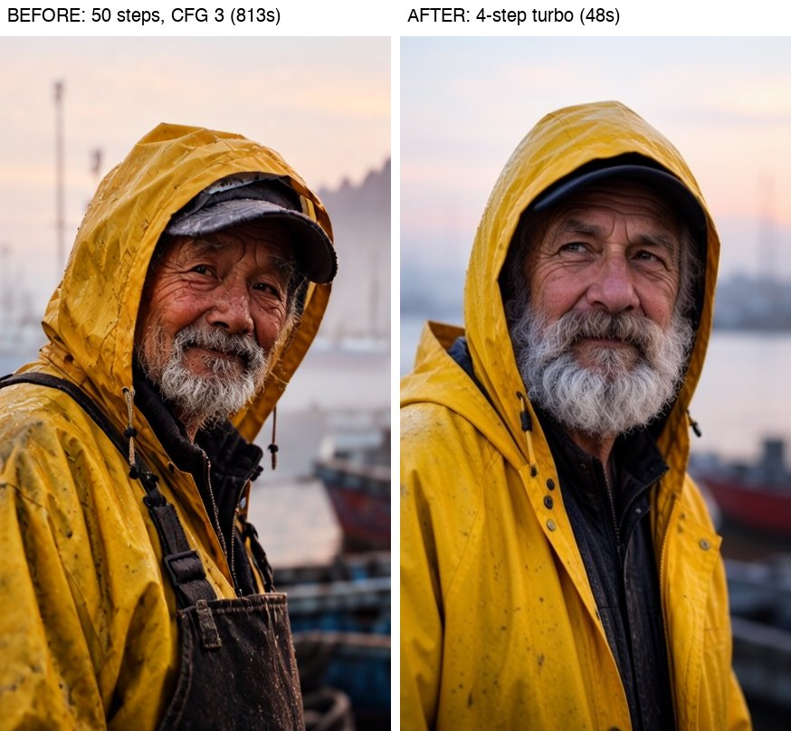
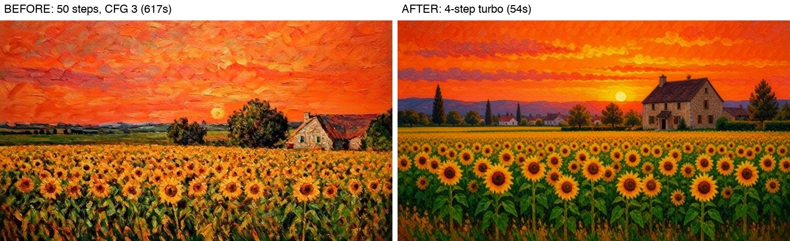
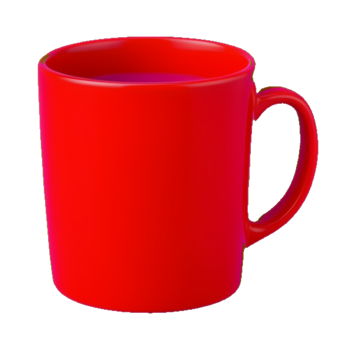
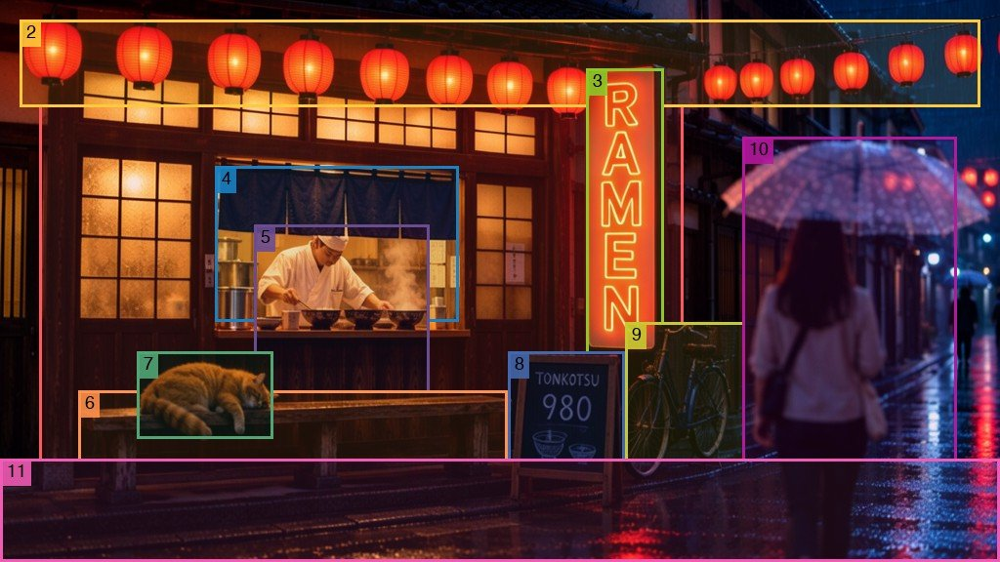
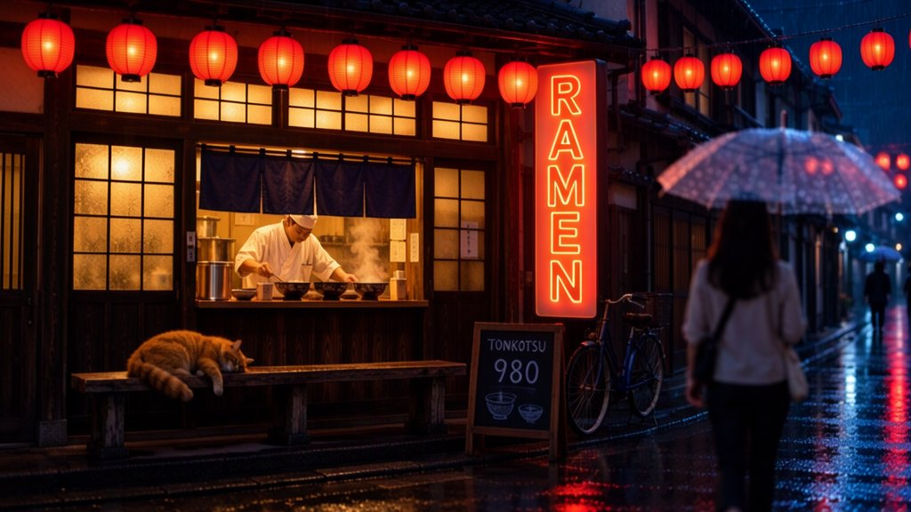

# moss-image-mac

**Run [MOSS-Image-SFT](https://huggingface.co/OpenMOSS-Team/MOSS-Image-SFT) locally on an Apple Silicon Mac and use it from any MCP app.**
4-bit (INT4) model, ~9 GB of memory, one setup command, about 30 seconds per image. Text in images renders reliably,
you can place elements with bounding boxes, edit images (inpainting / image-to-image), and make transparent cutouts.

[](LICENSE)


| Text & layout | Photoreal | Painting |
|---|---|---|
|  |  |  |

*Left of each pair: official settings (50 steps, CFG 3, ~10-15 min). Right: the default `standard` mode (4 steps, ~30-50 s). Same prompt and seed, base M4 Mac mini.*

---

## Quick start: Web UI

The easiest way to use the model is the built-in web interface — no MCP app or terminal skills needed:

```bash
./setup.sh          # one-time: downloads models (~9 GB) and creates the environment
./start_ui.sh       # starts the UI and opens http://127.0.0.1:7877 in your browser
```

The UI starts the MOSS backend automatically on demand — the first render pays an extra
~15 s while the models load, later renders reuse them.

What's in the interface:

- **Generate** — type a prompt (Cyrillic works, text inside images renders reliably), pick an
  aspect ratio or custom size, quality (`draft` 3 steps ≈ 15 s, `standard` 4 steps ≈ 25 s,
  `high` 50 steps ≈ 10 min), a seed (−1 = random), a batch of up to 4, and optional 2× upscale.
  ⌘/Ctrl + Enter submits.
- **Queue** — jobs render one at a time with live progress (sampler step, elapsed time).
  ✕ cancels a running render or removes a queued one.
- **Gallery** — everything in `outputs/`, with pagination (10 / 50 / 100 / all per page) and
  sorting by date or size. Click an image to view it: `←` / `→` flip through, Esc closes,
  and the panel offers Download, Upscale 2x and Delete.
- **Stop backend / Quit** (top right) — unload the models to free ~8 GB of memory, or shut
  the whole UI down. Relaunch anytime with `./start_ui.sh`.

To browse images from other folders in the gallery too:

```bash
MOSS_EXTRA_GALLERY_DIRS="/path/to/folder:/another/folder" ./start_ui.sh
```

Tip: on macOS you can make a double-clickable launcher by wrapping `start_ui.sh` in an app
bundle (Automator → "Application" that runs a shell script works fine) and dropping it on
the Desktop.

---

## Contents

- [Quick start: Web UI](#quick-start-web-ui)
- [What you get](#what-you-get)
- [Requirements](#requirements)
- [Install](#install)
- [Connect it to your app (MCP)](#connect-it-to-your-app-mcp)
- [Tools](#tools)
- [Scene composition with overlapping boxes](#scene-composition-with-overlapping-boxes)
- [Quality modes and speed](#quality-modes-and-speed)
- [Prompting tips](#prompting-tips)
- [Command line and HTTP API](#command-line-and-http-api)
- [Configuration](#configuration)
- [Reliability](#reliability)
- [How it works](#how-it-works)
- [Troubleshooting](#troubleshooting)
- [Development](#development)
- [Credits and licenses](#credits-and-licenses)

## What you get

- **An MCP server** (`moss_mcp.py`) with six tools: text-to-image, bounding-box layout, transparent single-object cutouts,
  inpainting, image-to-image, and a status check. Images come back inline and as full PNGs on disk.
- **Three quality modes on the same files and memory:** `draft` (3 steps), `standard` (4 steps, default) and
  `high` (the official 50-step / CFG 3 settings, pixel-identical to the reference pipeline).
- **A local HTTP backend** (stable-diffusion.cpp `sd-server` on Metal) with native, Automatic1111-compatible and
  OpenAI-compatible endpoints, for scripts and video/graphics pipelines.
- **A Python client and CLI** (`moss_client.py`) and a one-shot `generate.sh`.

Everything runs on your Mac. No cloud calls, no API keys.

## Requirements

| | |
|---|---|
| Mac | Apple Silicon (M1 or newer). Tested on a base **M4, 24 GB**. |
| Memory | 16 GB+ unified memory recommended (peak use is ~9 GB). |
| macOS | **26+** uses the prebuilt runtime. Older versions build it from source automatically (needs `cmake` and Xcode Command Line Tools). |
| Disk | ~13 GB free during setup, ~11 GB after. |
| Python | 3.10+ (or [uv](https://docs.astral.sh/uv/), which setup uses if present). |

## Install

```bash
git clone https://github.com/abhishekaryan23/moss-image-mac.git
cd moss-image-mac
./setup.sh
```

`setup.sh` downloads the runtime and model files at pinned versions and checks each one against its SHA-256 checksum.
Model downloads go through the [hf-mirror.com](https://hf-mirror.com) mirror by default; set `HF_ENDPOINT` to use a
different one (e.g. `HF_ENDPOINT=https://huggingface.co ./setup.sh`).
It also converts the turbo LoRAs to fp16 and creates `.venv` with the four Python dependencies. If a download is
interrupted, re-running resumes it, and files that are already complete are skipped. At the end it prints the exact
MCP config for your checkout.

Try it:

```bash
./generate.sh "a lovely cat holding a sign that says 'hello mac'"
```

or open the web UI (`./start_ui.sh`, see [Quick start: Web UI](#quick-start-web-ui) above).

## Connect it to your app (MCP)

The server speaks MCP over stdio. Replace `/path/to/moss-image-mac` with your clone's absolute path (`setup.sh` prints it).

**Claude Desktop**: `~/Library/Application Support/Claude/claude_desktop_config.json`, then restart Claude:

```json
{
  "mcpServers": {
    "moss-image": {
      "command": "/path/to/moss-image-mac/.venv/bin/python",
      "args": ["/path/to/moss-image-mac/moss_mcp.py"]
    }
  }
}
```

**Claude Code:**

```bash
claude mcp add moss-image -s user -- /path/to/moss-image-mac/.venv/bin/python /path/to/moss-image-mac/moss_mcp.py
```

**Cursor** (`~/.cursor/mcp.json`), **Windsurf** (`~/.codeium/windsurf/mcp_config.json`), **LM Studio** (`~/.lmstudio/mcp.json`)
and most other clients take the same `mcpServers` block as Claude Desktop.
**VS Code** (`.vscode/mcp.json` or user settings) uses `servers` instead:

```json
{ "servers": { "moss-image": { "type": "stdio",
  "command": "/path/to/moss-image-mac/.venv/bin/python",
  "args": ["/path/to/moss-image-mac/moss_mcp.py"] } } }
```

The first call starts the backend (~15 s extra while models load); later calls reuse it. Several apps can share one
backend. See [docs/mcp-clients.md](docs/mcp-clients.md) for details.

## Tools

| Tool | What it does | Key arguments |
|---|---|---|
| `generate_image` | Text to image | `prompt`, `aspect_ratio` (1:1, 16:9, 9:16, 4:3, 3:4, 3:2, 2:3, 21:9), `size` (fast / balanced / large), `quality`, `width`+`height`, `seed`, `upscale_2x` |
| `generate_layout_image` | Place text and objects in bounding boxes | `caption` (scene/style), `items: [{label, caption, box: [x0, y0, x1, y1]}]` in output pixels, top-left origin |
| `generate_cutout_object` | One isolated object plus a transparent RGBA PNG | `object_prompt`, `bg_color` (magenta default; green, white, gray, black, blue, #RRGGBB), `transparent` |
| `edit_image` | Inpainting: repaint only a region | `image_path`, `prompt` (describe the whole result), `mask_path` (white = change) **or** `mask_boxes`, `strength` |
| `transform_image` | Image to image (restyle, vary) | `image_path`, `prompt`, `strength` (0.3 subtle … 0.85 mostly new) |
| `image_server_status` | Start or check the backend | — |

| Layout boxes | Inpainting (`mask_boxes`) | Cutout (RGBA) |
|---|---|---|
|  |  |  |

## Scene composition with overlapping boxes

Layout boxes can **overlap and nest**, so you can compose a detailed scene in depth. In this example 11 boxes place a
neon sign on a shop facade, lanterns across it, a chef behind a curtain, a cat on a bench, and a woman with an umbrella
walking in front of a parked bicycle:



| `standard` (4 steps, ~70 s) | `high` (50 steps, CFG 3, ~21 min) |
|---|---|
|  |  |

```bash
.venv/bin/python examples/overlapping_scene.py                   # or --quality high
```

The spec is [`examples/overlapping_scene.json`](examples/overlapping_scene.json); the same `caption` and `items` work
in the `generate_layout_image` MCP tool. Tips are in [docs/layout-composition.md](docs/layout-composition.md).

## Quality modes and speed

All three modes use the same model files and the same memory. Times are for a warm backend on a base M4 (10-core GPU):

| `quality` | What runs | 768×432 / 576×576 | 1024×576 / 768×768 |
|---|---|---|---|
| `draft` | 3-step turbo LoRA | ~24-30 s | ~45 s |
| `standard` (default; `best` is an alias) | 4-step turbo LoRA | **~30-35 s** | ~55-65 s |
| `high` | Full model, official 50 steps, CFG 3 | ~10-11 min | ~21 min |

`size` presets per aspect ratio: `fast` ≈ 0.33 MP (e.g. 768×432), `balanced` ≈ 0.39 MP (832×464), `large` ≈ 0.59 MP (1024×576).
Custom `width`/`height` are snapped to multiples of 16 and limited to 256-1536 px per side and ~1.1 MP.

**When to use `high`:** finals where the finest texture matters (skin, fabric, brushwork). `standard` already renders
text and layout as well or better (see the comparison above), so it's the right default. In `high` mode the tools report
step-by-step progress, which keeps clients that reset their timeout on progress alive. If your app cancels long tool
calls anyway, run `high` from the CLI instead.

Why not faster? On a base M4, four forward passes of a 5B model are already near the GPU's limit. Faster options like
2-step LoRAs, tiny VAEs, caching and lower resolution all cost quality, so they are not used.
[docs/performance.md](docs/performance.md) has the measurements and everything that was tried.

## Prompting tips

- Put words that must appear in the image **in quotes**: `a neon sign that reads 'OPEN 24H'`. English and Chinese both work.
- In layouts, keep `caption` about style and scene and put every visible word in an item. Words in the caption may be rendered as text.
- Boxes can overlap: list background elements first, then the things on or in front of them, and say how they relate ("a cat asleep on the bench").
- Long, specific prompts (subject, setting, light, lens or medium) beat short ones, especially at larger sizes.
- For `edit_image`, the prompt describes the **whole** image you want, including what goes in the masked area.
- Use the same `seed` to reproduce an image or to compare modes.

## Command line and HTTP API

```bash
./generate.sh "prompt" 768 432 [seed] [standard|draft|high]     # uses the backend if running, else one-shot
./start_server.sh                                                # keep models loaded on 127.0.0.1:18765
.venv/bin/python moss_client.py "a red fox in snow" --width 768 --height 512 --quality high
.venv/bin/python moss_client.py "a red scarf" --init photo.png --mask mask.png
.venv/bin/python moss_client.py --layout examples/layout_poster.json --width 768 --height 768
.venv/bin/python moss_client.py "a porcelain teacup" --cutout --bg-color magenta
```

From Python:

```python
from moss_client import generate, layout_prompt
path, seconds = generate("a lighthouse at dawn, watercolor", 768, 432, seed=7, out="lighthouse.png")
```

The backend exposes `/sdcpp/v1/img_gen` (async jobs), `/sdapi/v1/txt2img|img2img` (Automatic1111) and
`/v1/images/generations` (OpenAI). Calling it directly requires the turbo parameters described in
[docs/http-api.md](docs/http-api.md).

## Configuration

| Variable | Default | Purpose |
|---|---|---|
| `MOSS_PORT` | `18765` | Backend port. Not 7860, which Stable Diffusion WebUI usually occupies. |
| `MOSS_HOST` | `127.0.0.1` | Backend bind address. The API has no authentication, so keep it local. |
| `MOSS_OUTPUT_DIR` | `./outputs` | Where the MCP tools save PNGs. |
| `MOSS_KEEP_SERVER` | unset | Set to `1` to keep a backend running after the MCP app that started it quits. |
| `MOSS_SERVER` | `http://127.0.0.1:$MOSS_PORT` | Full backend URL for the client. |
| `MOSS_ALLOW_FLAT` | unset | Set to `1` to accept intentionally flat or blank images (see below). |

Add environment variables to your MCP config with an `"env": {...}` block next to `command`.

## Reliability

These failure cases are handled and covered by tests (`tests/`):

| Situation | Behaviour |
|---|---|
| Two apps start at the same moment | A file lock lets only one backend load. Two copies would exhaust GPU memory. |
| Port already used by another program (e.g. a WebUI) | Detected by checking the server's identity; you get a clear error. |
| GPU runs out of memory (blank image) | Detected; reported as an error instead of saving a gray image. |
| App cancels or times out a call | The backend job is cancelled, so it doesn't block the queue. |
| The app that started the backend quits mid-job | Other apps restart the backend and retry once. |
| Long `high` renders | Live queue position and step progress. |
| Bad input (size, empty prompt, missing or unreadable image, empty mask, boxes off-canvas) | Rejected immediately with a specific message. |
| Setup not run / models missing | Tells you to run `./setup.sh`. |

## How it works

```
MCP app ──stdio──▶ moss_mcp.py ──▶ moss_client.py ──HTTP──▶ sd-server (stable-diffusion.cpp, Metal)
                                                              ├─ Qwen3.5-9B Q4_K_M  (text encoder)
                                                              ├─ MOSS-Image-SFT 5B DiT, Q4_0 (+ fp16 turbo LoRA at runtime)
                                                              └─ FLUX.2 small VAE decoder
```

- **4-bit DiT (Q4_0, 3.3 GB).** On Metal it is as fast as or faster than Q4_K, and it is the same size.
- **Turbo LoRA ([akhaliq 4-step / 3-step DMD](https://huggingface.co/akhaliq/MOSS-Image-SFT-4-steps)).** It runs 4 forward
  passes instead of 100. It is kept *unmerged* in fp16: merging into 4-bit weights destroys the fine detail it encodes, and
  fp16 runs ~20% faster than fp32. The noise levels sent with each request are the release scheduler's exact anchors
  (`1.0, 0.91, 0.717, 0.024`).
- **`high` mode** drops the LoRA and runs the official 50-step / CFG 3 / shift 5 schedule with layer-22 skipping on the
  negative branch. Its output is pixel-identical to a reference `sd-cli` run with the same seed.

More: [docs/architecture.md](docs/architecture.md).

## Troubleshooting

See [docs/troubleshooting.md](docs/troubleshooting.md). The common cases:

- **"model files missing"**: run `./setup.sh`.
- **"port … is used by another service"**: set `MOSS_PORT` to a free port (in your MCP config's `env`).
- **"blank image … GPU ran out of memory"**: close other GPU-heavy apps (other local models, games, a second backend) and retry.
- **Backend log**: `logs/sd-server.log`.

## Development

```bash
PYTHONPATH=. .venv/bin/python -m unittest discover -s tests -t .   # 22 tests, no GPU needed (fake backend)
```

Layout: `moss_mcp.py` (MCP tools), `moss_client.py` (HTTP client, prompts, cutout matting, CLI), `start_server.sh`,
`generate.sh`, `setup.sh`, `scripts/convert_lora_fp16.py`, `docs/`, `tests/`.

## Credits and licenses

The code in this repo is [MIT](LICENSE). The runtime and model weights are downloaded from their authors and keep
their own licenses (all Apache-2.0 or MIT as of 2026-10). See [THIRD_PARTY.md](THIRD_PARTY.md).

- [MOSS-Image](https://huggingface.co/OpenMOSS-Team/MOSS-Image-SFT) by the OpenMOSS team (arXiv:2610.23374)
- [stable-diffusion.cpp](https://github.com/leejet/stable-diffusion.cpp) by leejet, plus its GGUF conversion
- [MOSS-Image-SFT-4-steps](https://huggingface.co/akhaliq/MOSS-Image-SFT-4-steps) turbo LoRAs by akhaliq
- [Qwen3.5-9B](https://huggingface.co/Qwen/Qwen3.5-9B) (GGUF by unsloth), FLUX.2 VAE (via Comfy-Org)

This is an independent community project, not affiliated with OpenMOSS, Apple or Anthropic.
