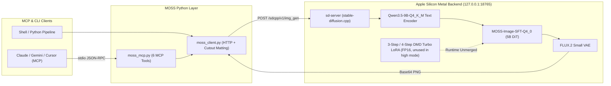
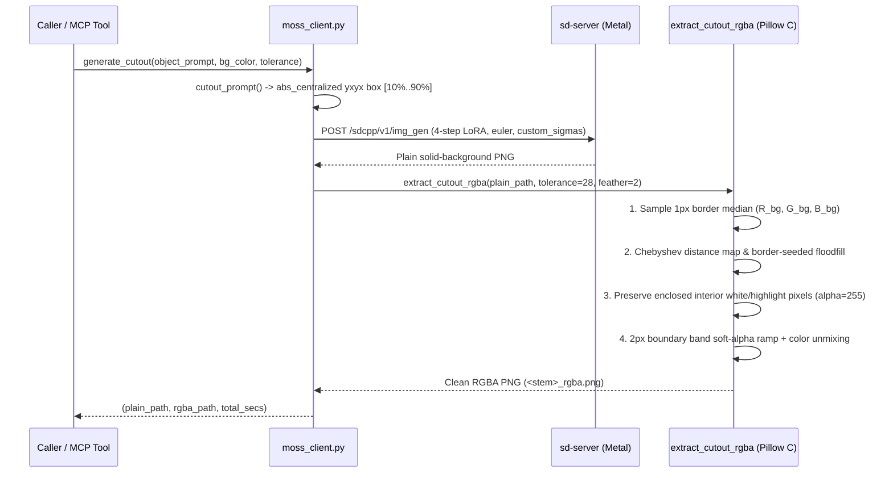
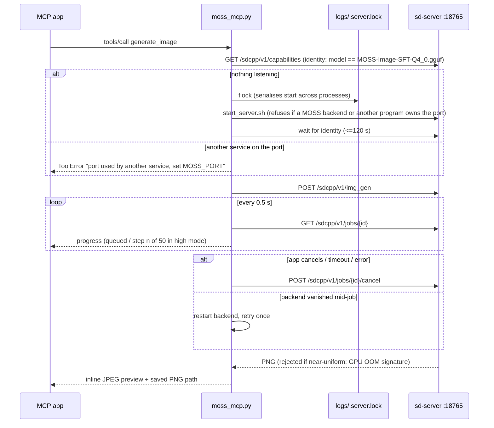

# MOSS-Image-SFT (INT4) — System Architecture (HLD & LLD)

## 1. High-Level Design (HLD)

The local MOSS-Image-SFT system exposes a 5B-parameter Diffusion Transformer (`MOSS-Image-SFT-Q4_0.gguf`) paired with `Qwen3.5-9B-Q4_K_M.gguf` text encoding, `flux2_ae_small.safetensors` VAE decoding, and 3-step/4-step DMD Turbo LoRAs over Apple Silicon Metal via `stable-diffusion.cpp` (`sd-server`), wrapped by a Python client (`moss_client.py`) and an MCP stdio server (`moss_mcp.py`).

Quality modes map to sampler settings in `moss_client.generate`: `draft` = 3-step LoRA, `standard` = 4-step LoRA (both CFG 1 with the release scheduler's snapped sigmas), `high` = no LoRA, 50 steps, CFG 3 (official settings).

---

## 2. Low-Level Design (LLD) — Two-Stage Single-Object Cutout Pipeline

Standard text-to-image prompts produce floor shadows, studio cyclorama gradients, or canvas edge clipping, and naive global thresholding erases white highlights inside the object. Our two-stage pipeline solves both failure modes:

1. **Stage 1 (`cutout_prompt`)**: Wraps the single object inside MOSS's native `abs_centralized` `yxyx` bounding box with a `10%` outer margin (`[0.10*W, 0.10*H, 0.90*W, 0.90*H]`) and explicit flat-matte lighting directives (`zero cast shadows, no floor, no horizon line, no vignette`). This guarantees the outer 10% frame perimeter is pure solid background and prevents any extremity from clipping the canvas edge.
2. **Stage 2 (`extract_cutout_rgba`)**: Samples the median RGB color along the 1px outer perimeter, computes a C-accelerated Chebyshev distance map (`ImageChops.difference` + `ImageChops.lighter`), and seeds `ImageDraw.floodfill` exclusively from perimeter pixels. Interior matching colors (e.g. white feathers, porcelain dials, specular glints) remain completely unreachable from the border and keep `alpha = 255`. Finally, a 2px morphological boundary band (`MaxFilter(5) - ext_bg`) receives continuous alpha ramping and foreground color decontamination:
   $$C_{\text{fg}} = \text{clip}\left(\frac{C_{\text{obs}} - (1 - \alpha) C_{\text{bg}}}{\max(\alpha, 0.20)}, 0, 255\right)$$

---

## 3. Backend lifecycle and failure handling

- Expected failures are raised as `MossError` in the client and converted to MCP `ToolError` in the server, so the
  user sees the actual message (MCP SDK 2.x hides the text of any other exception).
- A backend started by an MCP process runs in its own session and is stopped when that process exits, unless
  `MOSS_KEEP_SERVER=1`. Other MCP processes using it recover through the retry above.
- Step previews (`preview: proj`) are requested only for full-model renders; they cost ~1% and turbo jobs don't need them.
